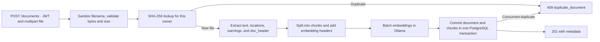
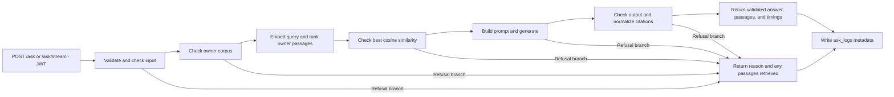
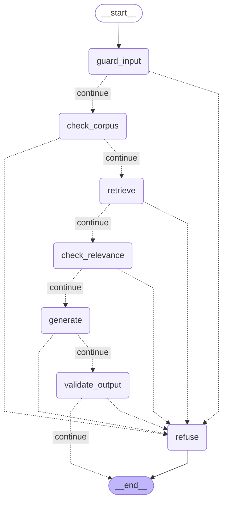

# Design decisions

## Architecture

### Choice

`app/config.py` owns defaults and environment settings. `schemas.py` defines the API boundary. `ingestion/` validates and prepares uploads, `retrieval.py` ranks passages, `generation.py` builds prompts, and `guardrails.py` checks input and output. `graph.py` controls question branches, `asking.py` adapts them to JSON and SSE, and `repository.py` persists data. `main.py` handles HTTP, dependencies, and lifecycle, and delegates business logic to those modules. [Application source](app/)

**Upload flow**

**Question flow**

**Generated LangGraph diagram** [Source](docs/ask_graph.mmd)

### Why

The notebooks and evaluation runner exercise the same extraction, retrieval, and question logic as the server. Layer boundaries let API tests replace model clients while exercising PostgreSQL and the real workflow. [Notebooks](notebooks/) · [API tests](tests/api/)

### Alternatives rejected

Putting retrieval and prompting inside route handlers would couple the experiments and tests to HTTP. Separate ingestion and retrieval services would add network calls and deployment pieces for a single-machine project.

### Trade-offs (quality, cost, speed, latency)

Explicit boundaries make failures easier to locate and keep model calls out of unit tests. They add modules to navigate. Uploads wait for extraction, embedding, and the database commit, giving callers a clear point at which the document is ready for retrieval.

## Corpus

### Choice

The fictional Tarnwick Consulting corpus contains 19 documents across five formats. It includes nine Markdown files, four DOCX, four PDF, one PPTX, and one TXT. The scanned PDF is the single textless fixture, leaving 18 indexable files. [Corpus](corpus/) · [Extraction notebook](notebooks/01_extraction.ipynb)

Planted cases include leave v1 versus v2 (18 versus 21 working days and 5 versus 10 days of carry-over), an older FAQ that still gives 18 days, hidden instructions in `code_of_conduct.docx`, a scanned office notice, and structured policy tables in the expense PDF and leave DOCX. [Golden set](evals/golden_set.json) · [Corpus](corpus/)

### Why

An invented company keeps confidential company material outside the public demo and gives the author control over expected answers and source evidence.

### Alternatives rejected

Real company policies would require publication permission and redaction. A clean corpus with no conflicts or malformed uploads would give less evidence about failure behavior.

### Trade-offs (quality, cost, speed, latency)

A small fixture set makes repeated extraction and evaluation affordable on a CPU. It has limited variation in formatting, language, and document length, so its scores apply to this corpus.

## Text extraction

### Choice

| Format | Extraction | Citation location |
| --- | --- | --- |
| PDF | PyMuPDF opens the document. pymupdf4llm extracts Markdown per page, including tables where available, with plain PyMuPDF text fallback when Markdown extraction raises an exception. | One-based page and first Markdown heading, when present |
| DOCX | python-docx visits paragraphs and tables in body order. Title and heading styles become Markdown headings, and table rows become Markdown. | Title or Heading 1 section, when present |
| PPTX | python-pptx reads slide text frames, tables as Markdown, and speaker notes. | One-based slide number and title, when present |
| Markdown | UTF-8 decoding with replacement and splits at H1 and H2. Source Markdown, including table rows, stays in the text. | Heading, when present |
| Plain text | UTF-8 with a Windows-1252 fallback. | Filename |

The extractor normalizes whitespace and Unicode. A document with fewer than 20 non-whitespace characters across its extracted sections raises `no_extractable_text`. Word runs directly formatted below 4 pt or white are reported as warnings and retained as source data. Image-only PDFs receive HTTP 400 through the upload API. [Extractor](app/ingestion/extractors.py) · [Extraction notebook](notebooks/01_extraction.ipynb)

### Why

Keeping rows and columns together helps answer questions about numeric policy limits. Page, slide, and section metadata locate the evidence in the source.

### Alternatives rejected

A universal plain-text pass would lose table structure and some source locations. OCR was left out of scope to keep the CPU workload and runtime dependencies bounded.

### Trade-offs (quality, cost, speed, latency)

Layout extraction takes more work than plain-text extraction. Complex PDF layouts can still lose structure, Word sections lack page numbers, and the hidden-text check covers only the explicit formatting it tests. Scans need a text layer before ingestion.

## Chunking strategy

### Choice

**Fixed** uses 120-word windows with 25 words of overlap. It flattens whitespace and uses the page and section of the window's first word. **Structure**, the service default, packs prose and table blocks toward 120 words and splits long blocks with a 200-word limit. It preserves table rows and repeats the header when a table spans chunks. A single oversized row can exceed the cap. Chunks under 40 words merge into a fitting previous or next chunk on the same page when possible. PowerPoint can also merge forward across slides, keeping the first slide number and combining titles. [Chunker](app/ingestion/chunking.py)

Both strategies prepend `Document: <filename> | Section: <heading>` for embedding. The stored evidence retains the chunk body. The separate `doc_header` stores up to 200 characters from the first two nonempty extracted lines for version-aware generation. [Ingestion](app/ingestion/pipeline.py) · [Generation](app/generation.py)

### Why

Longer Markdown files produced sections averaging about 70 words when split only on headings. Packing blocks avoids spreading short sections across too many hits. A 120-word target also lets retrieval select a part of a document from a corpus whose files are typically 150–250 words long. The chunking notebook shows a fixed window cutting the hotel row and structure keeping it intact. [Chunking notebook](notebooks/02_chunking.ipynb)

| Saved retrieval configuration | Hit@1 | Hit@4 | Recall@4 | Recall@8 | MRR |
| --- | ---: | ---: | ---: | ---: | ---: |
| Fixed + dense | 0.8485 | 0.9091 | 0.8939 | 1.0000 | 0.8854 |
| Fixed + hybrid | 0.8788 | 0.9091 | 0.9091 | 1.0000 | 0.9005 |
| Structure + dense | 0.8485 | 0.9091 | 0.8939 | 1.0000 | 0.8902 |
| Structure + hybrid | 0.8485 | 0.9091 | 0.9091 | 1.0000 | 0.8952 |

The saved evaluation indexed 37 fixed chunks and 34 structure chunks over the same 18 documents. Fixed plus hybrid won on MRR and was used for answer evaluation. Structure remains the service default for layout preservation. The notebook's saved structure count of 38 comes from its earlier comparison, so use the timestamped retrieval artifact for the benchmark counts. [Evaluation](EVAL.md#configuration-comparison) · [Retrieval artifact](evals/results/retrieval_20261125_070715_670686Z.json)

### Alternatives rejected

Heading-only splitting left short fragments. Larger windows would often cover a whole document. The project kept both fixed and structure strategies to measure layout preservation and retrieval ranking separately.

### Trade-offs (quality, cost, speed, latency)

Fixed overlap duplicates text across embeddings and can split tables. Structure often supplies cleaner passage boundaries but produces variable lengths. More chunks increase ingestion work, and more retrieved text increases model input and can add latency.

## Embedding model

### Choice

Ollama serves multilingual `bge-m3` locally with 1,024-dimensional vectors. The service embeds chunks in batches of 16 by default, embeds each question for cosine search, and validates returned vector length and finite values. [Settings](app/config.py) · [Embedding client](app/llm_client.py)

### Why

The same embedding model can match Urdu questions to English policy passages. Running it locally removes a paid embedding API and keeps the embedding inputs on the local service. The cloud generation path still sends the question and selected passages to Groq. [Retrieval notebook](notebooks/03_embedding_retrieval.ipynb) · [Urdu results](EVAL.md#results)

### Alternatives rejected

OpenAI `text-embedding-3-small` would add an external embedding call and credential. Ollama `nomic-embed-text` was another local option. The checked-in Urdu retrieval results belong to `bge-m3`.

### Trade-offs (quality, cost, speed, latency)

There is no per-request embedding bill. CPU inference adds local processing time and uses memory, especially when indexing a batch. Switching vector dimension or model needs a compatible schema and re-embedding before retrieval scores can be compared.

## Vector database

### Choice

PostgreSQL 16 stores accounts, document metadata, chunks, and ask logs. The author's Docker environment used pgvector 0.8.7 on host port 5433. The Compose file uses the `pg16` image tag. Chunks store owner, document ID, position, page or slide, section, text, word count, and vector. HNSW uses `vector_cosine_ops`. An English `tsvector` column and GIN index support keyword retrieval. [Compose configuration](docker-compose.yml) · [Schema](app/db.py)

### Why

One transaction commits a document and its chunks. Retrieval checks `owner_id` on both sides of the join. Deleting a document cascades to its chunks through the foreign key, so subsequent retrieval cannot return those deleted rows. Filename and version header are joined from the document. [Repository](app/repository.py) · [Retrieval](app/retrieval.py)

### Alternatives rejected

An in-memory index would need separate persistence and delete synchronization. Qdrant would be a reasonable option if vector load, filtered approximate search, or independent horizontal scaling became the bottleneck.

### Trade-offs (quality, cost, speed, latency)

PostgreSQL consolidates operations and keeps deletes consistent. HNSW and GIN add disk, memory, and write overhead as the corpus grows. Measure owner-filtered query plans and recall under load before changing index settings or adding a dedicated vector service.

## Retrieval settings

### Choice

The default returns `top_k=4`. Dense and keyword search each take up to `candidate_k=20` candidates. Hybrid ranking sums `1 / (60 + rank)` for each list containing the chunk. The API exposes cosine similarity, keyword rank, and RRF score. If the best cosine similarity among returned chunks is below `0.45`, the graph refuses before generation. [Retrieval](app/retrieval.py) · [Workflow](app/graph.py)

### Why

The off-topic France-capital question had a best cosine similarity of 0.3304 in the retrieval notebook. In-corpus leave results were about 0.61–0.66 in the same notebook. The gate sits between them. In the fixed-window comparison, hybrid raised MRR from 0.8854 to 0.9005 and recall@4 from 0.8939 to 0.9091. [Retrieval notebook](notebooks/03_embedding_retrieval.ipynb) · [Evaluation](EVAL.md#configuration-comparison)

### Alternatives rejected

Dense-only retrieval stays available for comparison. A paid reranker would add a provider call and send more candidate text outside the local database. RRF uses rankings already computed locally and needs no additional model.

### Trade-offs (quality, cost, speed, latency)

Four passages keep generation context small, but relevant evidence can rank fifth or lower. The observed threshold is a heuristic and the English keyword index is less useful for Urdu. Recall@8 reached 1.0000 in this corpus, so expanding or selectively reranking the candidate context is worth evaluating against the extra tokens and latency.

## LLM

### Choice

Groq `openai/gpt-oss-20b` generates answers by default, with Ollama `qwen2.5:3b` as the generation fallback. Groq `qwen/qwen3.8-27b` judges the saved evaluation. The service caps answer output at 400 tokens and prompts for about 150 words or fewer. The provider context window for `openai/gpt-oss-20b` is **TBD**. [Settings](app/config.py) · [Prompt](app/generation.py)

### Why

The author timed one short prompt on Windows 11 with a CPU, 16 GB RAM, and no GPU. These provider measurements cover the prompt alone. The saved full answer run measured 1,001.08 ms p50 and 1,849.71 ms p95 across 40 completed requests. [Evaluation latency](EVAL.md#results)

| Model | Serving path | Observed short-prompt time |
| --- | --- | ---: |
| `qwen2.5:3b` | Local Ollama | 19.1 s |
| `openai/gpt-oss-20b` | Groq | 0.66 s |
| `qwen/qwen3.8-27b` | Groq | 0.37 s |

### Alternatives rejected

The original plan used local generation first. The measured CPU wait favored Groq for the interactive answer path. The faster Qwen measurement is a latency observation. The saved answer comparison does not establish that Qwen would give better answers, and the evaluation keeps it as a separate judge. [Original plan](plans/PLAN.md) · [Evaluation](EVAL.md#results)

### Trade-offs (quality, cost, speed, latency)

Groq receives the question and selected passages for generation, and the question alone for Prompt Guard. With fallback enabled, a Groq 429 or provider failure can use local Ollama. Transient provider failures retry before fallback. A stream interrupted after provider deltas are received fails to avoid splicing completions. Local generation avoids the cloud generation call during fallback, but is slower on the measured CPU. [Model client](app/llm_client.py)

The author's recorded free-tier limits for the two Groq models were 30 requests/minute, 1,000 requests/day, 8,000 tokens/minute, and 200,000 tokens/day. Qwen also had a 1,000 output tokens/minute limit. The saved free-tier estimate was $0.00. Paid input and output rates per million tokens are **TBD**. Set the two `COST_PER_MILLION_*_TOKENS` variables to reflect the rates for a paid run. [Settings](app/config.py) · [Evaluation](EVAL.md#results)

## Prompt design

### Choice

The system prompt grounds company facts in retrieved passages, requests separate `[C1]` citation markers for factual sentences, and asks the model to answer in the question's language. It expects the exact `NOT_IN_DOCUMENTS` sentinel when evidence is missing. The graph maps it to a user-facing refusal. Context is escaped and delimited as untrusted data. The prompt compares version and effective-date text in `doc` attributes from `doc_header`, asks for the newest policy, and asks the model to mention and cite an older conflicting policy. A canary detects leakage. [Prompt](app/generation.py)

### Why

Separate markers let the backend tie the response to specific retrieved chunks. Guardrails normalize common citation variants, remove unknown IDs, and refuse if no retrieved ID remains. The iteration moved from 19/33 correctness on re-judged baseline answers to 29/33 and cut false refusals from 13 to 1 under the same correctness rubric. The evaluation measures the combined prompt and citation changes. [Validation](app/guardrails.py) · [Before and after](EVAL.md#iteration-before-and-after)

### Alternatives rejected

Free-form source names would be difficult to associate with individual passages. Canonical-only parsing rejects alternate citation formats. The baseline recorded 12 `ungrounded` refusals, and its saved artefacts do not retain the raw drafts. Selecting policy versions by filename alone would overlook dates and version markers in the document text. [Before and after](EVAL.md#iteration-before-and-after)

### Trade-offs (quality, cost, speed, latency)

Headers and instructions add prompt tokens. Citation validation checks membership in retrieved context. It does not prove that each claim is entailed or that the latest policy was retrieved. The leave entitlement failures demonstrate the gap. [Failure analysis](EVAL.md#failure-analysis)

## Framework choice

### Choice

Use LangGraph `StateGraph` for question answering and plain async Python for upload orchestration. Model fallback stays in the shared provider client. [Workflow](app/graph.py) · [Ingestion](app/ingestion/pipeline.py) · [Model client](app/llm_client.py)

### Why

The question path branches after the input checks, corpus check, relevance gate, generation, and citation validation. LangGraph makes those outcomes explicit and emits stage events for the UI. The upload path is a straightforward sequence of validation, extraction, embedding, and persistence.

### Alternatives rejected

A general LangChain chain or agent abstraction would hide decisions the project needs to inspect. The project uses LangGraph and its underlying `langchain_core` types while implementing retrieval, prompting, and provider calls directly. A hand-written state machine was possible, but would need its own graph and event plumbing.

### Trade-offs (quality, cost, speed, latency)

The graph adds dependency and state-management overhead and makes branch tests and diagrams easier to maintain. There is no graph execution dependency on a remote orchestration service. The app disables LangSmith tracing for ask execution. [Ask service](app/asking.py)

## API design

### Choice

Expose document resources through `POST`, `GET`, and `DELETE`. Use `201` for creation, `200` for reads and answers, and `204` for deletion. Publish request and response schemas in Swagger. Provide `POST /ask` for complete JSON and `POST /ask/stream` for SSE. The stream emits live `stage` notifications, then validated `token` events and a terminal `done` payload, or `error` on failure. [Endpoints](app/main.py) · [Schemas](app/schemas.py)

### Why

The terminal answer and chunks keep streaming and non-streaming results comparable. Buffering provider deltas until validation keeps unsafe drafts out of the browser. The shared per-client ask limit is 20/minute across both routes. Uploads are limited to 30/minute and login to 10/minute. Request IDs correlate responses and logs through `X-Request-ID`. [Ask service](app/asking.py) · [Request logging](app/logging_config.py)

### Alternatives rejected

Unvalidated token streaming could expose a blocked draft. A WebSocket would add connection and message protocol handling to a one-request, one-response workflow. Polling for completion would add repeated HTTP requests and delay progress updates.

### Trade-offs (quality, cost, speed, latency)

SSE gives immediate progress while the verified answer arrives after generation, so initial text latency includes validation. Once streaming starts, a late failure has to use the event channel because the response status has already been sent.

## Guardrails

### Choice

| Surface | Checks | Verification |
| --- | --- | --- |
| Input | Trim and require a question. Default maximum is 1,000 characters. Regexes check instruction override, prompt disclosure, jailbreak roles, and some encoded-execution requests. Optional Groq Prompt Guard flags scores of at least 0.5. Missing classifier verdicts leave the regex checks in effect. | Unit tests try attack phrases and ordinary questions. API tests verify 422 for invalid length and confirm a regex match short-circuits before the fake classifier. |
| Output | Identify the sentinel, normalize citations, drop IDs outside the retrieved set, and refuse when no valid ID remains. Block the system-prompt canary, credential-shaped strings, and some quoted prompt disclosures. | Unit tests cover citation variants, invalid IDs, and sensitive text. API tests verify a blocked stream emits no answer tokens. |
| Upload | Validate nonempty size and the 10 MB cap, allow only five extensions, check PDF and Office ZIP magic bytes, validate text bytes, and reject failed parsing or unusable text. Warn on tiny or white Word runs. | Unit tests exercise filenames, signatures, size, table extraction, and hidden text. API tests cover unsupported and corrupt files, empty bytes, duplicates, and the scan. |

[Guardrails](app/guardrails.py) · [Upload validation](app/ingestion/validation.py) · [Test suite](tests/)

### Why

Deterministic checks handle obvious invalid inputs before a model call. The model and output checks provide additional controls for cases the input regexes miss. Document text stays within the evidence boundary even when it contains instruction-like content.

### Alternatives rejected

A prompt alone would not stop malformed uploads or check cited IDs. Automatically stripping every suspicious run could silently remove legitimate evidence. The project shows a warning and keeps the source passage available for review.

### Trade-offs (quality, cost, speed, latency)

Regex rules can miss new phrasings or flag benign ones. The classifier adds a cloud call when the input regexes pass. Signature checks verify only expected leading bytes, so parsing still matters. These controls reduce some failure modes and leave semantic grounding to evidence review and evaluation.

## Error handling

### Choice

| HTTP status | Response code or meaning | When returned |
| ---: | --- | --- |
| 200 | Success or structured refusal | Reads, login, JSON ask, or opened SSE stream |
| 201 | Created | Account or document created |
| 204 | No content | Owned document deleted |
| 400 | `empty_file`, `corrupt_file`, `no_extractable_text` | Empty bytes, signature or parse failures, and files without usable text |
| 401 | `unauthorized`, `invalid_credentials` | Missing, invalid, or expired bearer credentials, unavailable account profile, or failed login |
| 404 | `document_not_found`, `http_error` | Missing or other-owner document, or unknown route |
| 405 | `http_error` | Unsupported HTTP method for a route |
| 409 | `duplicate_document`, `email_taken` | Same bytes already owned or email already registered |
| 413 | `file_too_large` | Upload above the configured size |
| 415 | `unsupported_file_type` | Extension outside the allowlist |
| 422 | `validation_error` | Invalid body, field, query, or path according to the request schema |
| 429 | `rate_limited` | SlowAPI quota, or a Groq rate limit surfaced with fallback disabled |
| 500 | `internal_error` | Unexpected server failure |
| 503 | `service_unavailable` or readiness body | Unavailable dependency, unusable JWT config for login or signup, or `/health` reporting a failed check |

Most errors use `{"error":{"code":"…","message":"…","request_id":"…"}}`. `/health` keeps its status body on 503. After the SSE response starts, errors are sent as terminal events in the same error shape. [Error classes](app/errors.py) · [HTTP handlers](app/main.py)

### Why

Stable codes let the UI distinguish validation, authentication, conflicts, and dependency failures. The request ID links the error message to server logs without echoing request payloads. [Request logging](app/logging_config.py) · [Frontend client](frontend/src/api/client.ts)

### Alternatives rejected

A generic 500 for expected input and quota cases would make troubleshooting harder. Raw exception text would risk exposing credentials, parameters, or infrastructure details.

### Trade-offs (quality, cost, speed, latency)

Stable envelopes need handler and client maintenance. Provider retries smooth over transient failures but can delay a final 503. PostgreSQL pool, connection, and command timeouts bound database waits. `/health` checks PostgreSQL and Ollama reachability and leaves Groq and actual model generation outside its probe. [Health check](app/health.py) · [Settings](app/config.py)

## Security

### Choice

JWTs use HS256 and require a UUID subject, issue time, and expiry. The default lifetime is 720 minutes. Passwords are bcrypt-hashed with 12 rounds, and signup caps passwords at 72 UTF-8 bytes. Protected endpoints use the verified owner ID. Secrets are configured in private `.env` or the process environment. CORS permits one configured browser origin. `ask_logs` stores counts, outcomes, IDs, provider, and timings without question or answer text. [Auth](app/auth.py) · [Database](app/db.py) · [API middleware](app/main.py)

### Why

Owner checks apply to lists, direct access, deletion, retrieval, and telemetry. Login gives the same response for an unknown email and a wrong password, and uses a dummy bcrypt check for an unknown email. The app rejects the public example JWT secret. [Repository](app/repository.py) · [Auth tests](tests/api/test_auth_api.py)

### Alternatives rejected

An anonymous shared corpus would expose documents across accounts. Plaintext passwords, token-bearing logs, and broad CORS would increase credential exposure. Server-side sessions would add storage and lifecycle work.

### Trade-offs (quality, cost, speed, latency)

Bcrypt intentionally adds computation and runs off the event loop. JWTs let document and ask routes verify without an account lookup on each request. The frontend stores the access token in browser local storage, and sign-out clears it there. The service has no token revocation list or refresh flow. Context sent to Groq still carries the privacy implications of a cloud provider. [Session client](frontend/src/api/session.ts) · [Auth](app/auth.py)

## Frontend

### Choice

PolicyDesk RAG uses React, Vite, strict TypeScript, Tailwind, TanStack Query, and Motion for login, signup, Ask, Documents, and Insights. The interface uses a forest-green rail and sand surfaces with light, dark, and system theme choices. IBM Plex Sans is used for headings, controls, and answers. IBM Plex Mono aligns numbers, scores, IDs, and latencies. [Frontend source](frontend/src/) · [Theme styles](frontend/src/styles.css)

### Why

Each answer exposes retrieved passages and their scores. Citation chips open the matching passage and its location in a drawer. The UI also exposes upload warnings and refusal reasons. Focus indicators, keyboard controls, labels, and reduced-motion styles support access to those actions. [Ask components](frontend/src/components/) · [Screen styles](frontend/src/screens.css)

### Alternatives rejected

A chat-only screen would hide retrieval evidence. Server-rendered forms and a text-only CLI would make stage progress, document management, and source comparison more cumbersome for the demo.

### Trade-offs (quality, cost, speed, latency)

The richer client adds front-end state and bundle dependencies. SSE gives useful status feedback during the wait, while the UI still waits for the validated text. Uploads chosen together run through one client queue with individual progress and error states.

## Testing approach

### Choice

The current suite collected and passed **117 cases**, including parametrized cases. Unit tests work on isolated components, corpus fixtures, or mocked transport. ASGI API tests use real PostgreSQL and replace embeddings and LLM calls with deterministic clients. [Test suite](tests/)

| Test file | Cases | Coverage |
| --- | ---: | --- |
| `api/test_ask_api.py` | 15 | Answers, refusals, SSE, metrics, request limits, and provider fallback |
| `api/test_auth_api.py` | 13 | Signup, login, JWT failures, per-owner access, and recent metrics |
| `api/test_documents_api.py` | 11 | Upload, sample loading, duplicates, invalid files, list, and cascading deletion |
| `unit/test_chunking.py` | 16 | Fixed and structure boundaries, overlap, short chunks, tables, and metadata |
| `unit/test_eval_metrics.py` | 7 | Retrieval metrics, judge input and parsing, provider retry delay |
| `unit/test_extractors.py` | 9 | Corpus formats, tables, metadata, hidden Word runs, and failures |
| `unit/test_guardrails.py` | 30 | Input patterns, output blocking, and citation normalization |
| `unit/test_retrieval.py` | 2 | RRF and ordered citation assignment |
| `unit/test_validation.py` | 12 | Filenames, signatures, and sizes |
| `unit/test_version_context.py` | 2 | Header extraction and escaped prompt context |

### Why

Deterministic model doubles avoid network variance and free-tier quotas while exercising SQL and HTTP contracts. The extraction and chunking notebooks inspect real files. The retrieval notebook calls PostgreSQL and local `bge-m3`, and the answering notebook runs the real graph with providers. [Notebooks](notebooks/)

### Alternatives rejected

Mocking PostgreSQL would miss foreign-key cascades, vector queries, and database conflicts. Calling cloud models on every test run would make expected outputs and timing depend on external services.

### Trade-offs (quality, cost, speed, latency)

The API tests need a local pgvector database. Mocks validate control flow and contracts, while live notebooks and the evaluation expose provider and retrieval quality issues. Judge agreement rate and Cohen's kappa are **TBD** while human labels are pending. [Judge worksheet](evals/results/judge_review.csv) · [Judge reliability](EVAL.md#judge-reliability)

## Limitations and future work

### Choice

This release runs locally with a small fictional corpus and text extraction only. Database startup uses `create_all` and an `ALTER TABLE … ADD COLUMN IF NOT EXISTS` for `doc_header`. Full migrations, OCR, and deployment are future work. Provider free-tier quotas constrain live tests and evaluations. [Schema initialization](app/db.py) · [Evaluation](EVAL.md)

### Why

This scope makes the service reproducible on the author's CPU-only machine and preserves time for retrieval, grounding, and failure analysis. The latest saved failures show concrete work to do. [Failure analysis](EVAL.md#failure-analysis)

| Item | Remaining failure |
| --- | --- |
| `q01` | Current 21-day evidence ranked fifth. The answer used 18 days from the old sources. |
| `q24` | Pakistan Day evidence ranked seventh. The top-four answer falsely refused. |
| `q29` | Both policy sources were retrieved. The answer omitted the PKR 15,000 one-time stipend. |
| `m01` | Current 21-day evidence ranked eighth. The Urdu answer gave 18 days. |

### Alternatives rejected

Deploying first would introduce more operating and security work before evidence quality is measured. Raising `top_k` universally would include more evidence, but would also increase input size on questions that already retrieve sufficient support.

### Trade-offs (quality, cost, speed, latency)

Evaluate version-aware reranking or selective context expansion, date-aware holiday retrieval, and explicit coverage checks for multi-source answers. Add Urdu cases and human judge labels before drawing broader conclusions. OCR and migration tooling would improve coverage and maintainability at the cost of extra dependencies and operational steps.
